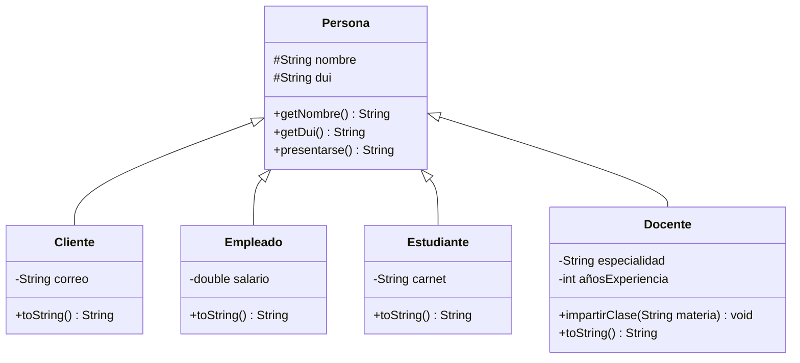

# Ejercicio 8.4: boceto de la jerarquía de herencia del proyecto

<!-- Ajusta los atributos de Cliente, Empleado y Estudiante a los de tu código real. -->

Notación UML: `#` = protected, `-` = private, `+` = public. El triángulo vacío (`<|--`) representa la relación "es un".

## Resumen de la jerarquía

| Clase | Relación | Atributos propios | Métodos propios |
|---|---|---|---|
| `Persona` | Superclase | `#nombre`, `#dui` (protected) | `presentarse()`, `getNombre()`, `getDui()` |
| `Cliente` | es una `Persona` | `correo` | `toString()` |
| `Empleado` | es una `Persona` | `salario` | `toString()` |
| `Estudiante` | es una `Persona` | `carnet` | `toString()` |
| `Docente` | es una `Persona` | `especialidad`, `añosExperiencia` | `impartirClase(materia)`, `toString()` |

Cada subclase muestra únicamente sus atributos y métodos propios; lo común (`nombre`, `dui`, `presentarse()`) se hereda de `Persona`.
